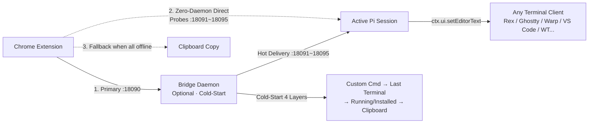

# 🚀 send-to-pi

[**简体中文**](./README_CN.md) | **English**

> Seamlessly bridge your web browser to the [Pi Coding Agent](https://github.com/earendil-works/pi-coding-agent). Send snippets, articles, or links directly into your Pi terminal prompt in **any terminal client**—with zero-daemon direct delivery when Pi is open, and 4-layer adaptive cold-start launch when it isn't.

[](https://www.npmjs.com/package/send-to-pi)
[](https://opensource.org/licenses/MIT)
[](https://nodejs.org/)
[]()

---

## 💡 Highlights

- 🔌 **Zero-Daemon Direct Mode (100% Terminal-Agnostic)**: When Pi is already running—in **Rex, Ghostty, iTerm2, Warp, WezTerm, kitty, Alacritty, VS Code, Cursor, Windows Terminal, tmux**, or any other terminal—the Chrome extension talks directly to Pi (`18091~18095`) and prefills via `ctx.ui.setEditorText()`. **No background daemon required for hot delivery.**
- 🪟 **Active Session Routing & Popup Switcher**: Tracks real user activity (`input` / `agent_start`) across multiple Pi sessions and routes to the most recently used window. Click the extension toolbar icon to view all online Pi sessions (project + terminal) and pin a target if needed.
- 🎯 **Prefill Mode (No Auto-Submit)**: Inserts formatted Markdown at your cursor without pressing Enter, so you can append instructions first.
- 📝 **HTML to Markdown & Clean Article Extraction**: Preserves `<pre><code>` language tags, indentation, tables, lists, quotes, and links. Extracts clean articles (including X/Twitter main posts).
- ⚡ **4-Layer Adaptive Cold-Start (Optional Bridge Daemon)**: Start the optional Bridge Daemon (`npx send-to-pi start`) to wake Pi even when closed:
  1. **Custom Command Template** (`PI_LAUNCH_CMD` or `~/.pi/send-to-pi/config.json`) — one-line escape hatch for any terminal client.
  2. **Last Used Terminal Memory** — Pi records the terminal you actually use (`~/.pi/send-to-pi/last-terminal.json`), so cold-start launches the right client (including **Rex**, Ghostty, Warp, WezTerm, kitty, Alacritty, iTerm2, Windows Terminal, etc.).
  3. **Running / Installed Smart Detection** — prefers currently running terminals before OS defaults.
  4. **Clipboard Fallback** — if no terminal can be launched, formatted Markdown is copied to your clipboard automatically so nothing is ever lost.
- 🔒 **100% Local & Private**: Loopback `127.0.0.1` only. Zero cloud calls, zero telemetry.

---

## 🛠️ Architecture



---

## 📦 Quick Start (2 Steps for Direct Mode)

### Step 1: Install the Pi Extension
```bash
pi install npm:send-to-pi
```

Restart or open `pi` in **any terminal**. The extension listens on `127.0.0.1:18091~18095`.

### Step 2: Load the Chrome Extension
```bash
npx send-to-pi extension
```

1. Open `chrome://extensions/` in Chrome or Edge.
2. Enable **Developer mode** (top-right).
3. Click **Load unpacked** and select the opened folder.

That's it! Highlight text on any page and press <kbd>Cmd+Shift+S</kbd> (Windows/Linux: <kbd>Alt+Shift+S</kbd>) or right-click to send directly into your active Pi terminal.

### Optional Step 3: Start Bridge Daemon (for Cold-Start Auto-Wake)
Only needed if you want `send-to-pi` to automatically launch a terminal when no Pi session is running:

```bash
npx send-to-pi start
```

Check live status anytime (shows both Bridge and Direct-Mode Pi sessions):
```bash
npx send-to-pi status
```

---

## ⚙️ Configuration (`~/.pi/send-to-pi/config.json` or Env Vars)

Run `npx send-to-pi config` to view your config path and effective settings.

Example `~/.pi/send-to-pi/config.json`:
```json
{
  "terminal": "rex",
  "launchCommand": "rex run --interactive --cwd \"{workdir}\" --keep-open -- pi",
  "focusOnSend": false
}
```

| Env Variable | Config Key | Default | Description |
| :--- | :--- | :--- | :--- |
| `PI_BRIDGE_PORT` | `bridgePort` | `18090` | Port listened by the optional Bridge Daemon |
| `PI_INTERNAL_PORT` | `internalPort` | `18091` | Starting port for Pi sessions (probes 5 ports) |
| `PI_WORKDIR` | `workDir` | Last Pi workdir / cwd | Working directory for cold-start launch |
| `PI_TERMINAL` | `terminal` | Auto (last used) | Preferred terminal (`rex`, `ghostty`, `iterm2`, `warp`, `wezterm`, `kitty`, `alacritty`, `wt`, `terminal`) |
| `PI_LAUNCH_CMD` | `launchCommand` | Empty | Custom launch command template with `{workdir}` placeholder |
| `PI_FOCUS_ON_SEND` | `focusOnSend` | `false` | Bring the target terminal app to front after sending (macOS) |

---

## 🆕 v1.3.0 Changes

- **Zero-Daemon Direct Delivery**: Chrome extension automatically falls back to probing active Pi sessions (`18091~18095`) when Bridge (`18090`) is not running—works out of the box on any terminal client.
- **Toolbar Popup Session Switcher**: View Bridge status and all online Pi sessions (workdir + terminal) and switch between Auto (most recent) or a pinned session.
- **Real Activity Tracking**: Added `input` and `agent_start` hooks in Pi extension so `activeAt` always reflects the window you are actively using.
- **4-Layer Cross-Client Cold-Start**: Added native **Rex** (plus Warp, kitty, Alacritty, WezTerm, Ghostty, iTerm2, Windows Terminal) support, automatic `last-terminal.json` memory, custom `launchCommand` template escape hatch, and clipboard fallback.

---

## 📄 License

MIT License © 2026 Wude
