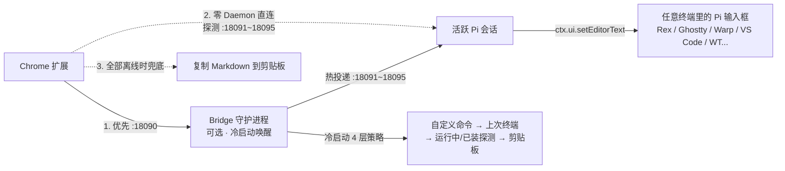

# 🚀 send-to-pi (浏览器网页一键发送至 Pi Agent)

**简体中文** | [**English**](./README.md)

> 让浏览器与 [Pi 终端编程助手](https://github.com/earendil-works/pi-coding-agent) 无缝打通。无论你使用 **Rex、Ghostty、iTerm2、Warp、WezTerm、kitty、Alacritty、VS Code、Cursor 还是 Windows Terminal**，打开 Pi 即可**零守护进程直连**预填到输入框；未打开时也可通过可选 Bridge 实现 4 层自适应冷启动唤醒。

[](https://www.npmjs.com/package/send-to-pi)
[](https://opensource.org/licenses/MIT)
[](https://nodejs.org/)
[]()

---

## 💡 核心特性

- 🔌 **零 Daemon 直连模式（100% 终端客户端无关）**：只要你的 Pi 正在运行（无论在 Rex、Ghostty、Warp、VS Code、Cursor、Windows Terminal 还是 tmux 里），Chrome 扩展在未检测到 `18090` Bridge 时会自动直连 `18091~18095` 的 Pi 扩展，通过 `ctx.ui.setEditorText()` 直接填入输入框——**无需常驻后台进程**。
- 🪟 **真实活跃会话路由 + 扩展弹窗选窗口**：Pi 扩展通过 `input` / `agent_start` 实时更新活跃时间，多开窗口时自动送到你刚聊天的那个窗口；点击浏览器工具栏扩展图标可查看全部在线 Pi 会话（项目名 + 终端名）并一键锁定目标窗口。
- 🧠 **智能长度分流（短文直填，长文自动落盘 `@路径`）**：≤ 1500 字（可配）直接预填进输入框；超长文章自动保存为 `~/.pi/send-to-pi/inbox/*.md`（自动定期清理），输入框仅填极简 3 行标题 + URL + `@文件路径`——既保留已登录浏览器的无损正文，又不刷屏输入框！可在弹窗一键切换「智能分流 / 全文直填 / 仅发链接」。
- 🎯 **Prefill 预填模式（绝不自动回车）**：内容送到输入框后停在末尾，方便你补充指令再回车发送。
- 📝 **HTML 智能转 Markdown & 正文提取**：保留代码块语言/缩进、表格、列表与链接，支持 X/Twitter 主帖及常见文章正文提取。
- ⚡ **4 层跨客户端冷启动（可选 Bridge 守护进程）**：当所有 Pi 都关闭时，若启动了 Bridge（`npx send-to-pi start`），按以下 4 层依次兜底：
  1. **自定义启动命令模板**（`PI_LAUNCH_CMD` 或 `~/.pi/send-to-pi/config.json`）：支持 `{workdir}` 占位符，任何小众终端一行接入。
  2. **记住上次实际运行 Pi 的终端**（`~/.pi/send-to-pi/last-terminal.json`）：原生支持 **Rex**、Ghostty、Warp、WezTerm、kitty、Alacritty、iTerm2、Windows Terminal 等，不再瞎猜或误开旧终端。
  3. **运行中终端优先 > 已安装终端 > 系统默认终端**。
  4. **剪贴板终极兜底**：冷启动失败或无运行中 Pi 时自动把排好版的 Markdown 复制到剪贴板并弹通知，绝不丢内容。
- 🔒 **纯本地隐私安全**：全链路走 `127.0.0.1`，无云端中转、零数据上报。

---

## 🛠️ 工作架构



---

## 📦 两步极速上手（直连模式）

### 第一步：安装 Pi 扩展
```bash
pi install npm:send-to-pi
```

在**任意终端**打开或重启 `pi`，扩展会自动在 `127.0.0.1:18091~18095` 待命。

### 第二步：加载 Chrome 扩展
```bash
npx send-to-pi extension
```

1. 在 Chrome / Edge 打开 `chrome://extensions/`；
2. 开启右上角 **开发者模式**；
3. 点击 **加载已解压的扩展程序**，选择弹出的文件夹即可。

现在即可在任意网页划词按 <kbd>Cmd+Shift+S</kbd>（Windows/Linux: <kbd>Alt+Shift+S</kbd>）或右键直发到 Pi 输入框！

### 可选第三步：启动 Bridge 守护进程（需要冷启动自动拉起终端时）
```bash
npx send-to-pi start
```

随时检查在线状态（同时显示 Bridge 与直连 Pi 会话）：
```bash
npx send-to-pi status
```

---

## ⚙️ 自定义配置（`~/.pi/send-to-pi/config.json` 或环境变量）

运行 `npx send-to-pi config` 查看配置文件路径与当前生效值。

示例 `~/.pi/send-to-pi/config.json`：
```json
{
  "terminal": "rex",
  "launchCommand": "rex run --interactive --cwd \"{workdir}\" --keep-open -- pi",
  "focusOnSend": false
}
```

| 环境变量 | 配置文件键 | 默认值 | 说明 |
| :--- | :--- | :--- | :--- |
| `PI_BRIDGE_PORT` | `bridgePort` | `18090` | 可选 Bridge 守护进程监听端口 |
| `PI_INTERNAL_PORT` | `internalPort` | `18091` | Pi 会话直连起始端口（自动探测 5 个端口） |
| `PI_DELIVERY_MODE` | `deliveryMode` | `smart` | 内容填充模式：`smart`（智能分流）/ `inline`（全文直填）/ `link`（仅发链接） |
| `PI_INLINE_LIMIT` | `inlineLimit` | `1500` | `smart` 模式下自动落盘转 `@路径` 的字数阈值 |
| `PI_WORKDIR` | `workDir` | 上次 Pi 目录 / cwd | 冷启动默认进入的工作目录 |
| `PI_TERMINAL` | `terminal` | 自动（上次终端） | 偏好终端（`rex`, `ghostty`, `iterm2`, `warp`, `wezterm`, `kitty`, `alacritty`, `wt`, `terminal`） |
| `PI_LAUNCH_CMD` | `launchCommand` | 空 | 万能自定义冷启动命令模板，支持 `{workdir}` 占位符 |
| `PI_FOCUS_ON_SEND` | `focusOnSend` | `false` | 设为 `true` 时热投递后自动切回对应终端窗口（macOS） |

---

## 🆕 v1.4.0 变更

- **智能分流落盘（防长文刷屏）**：超 1500 字正文自动保存至 `~/.pi/send-to-pi/inbox/*.md`（超过 7 天或 50 份自动清理），输入框仅填 3 行标题 + 链接 + `@路径` 引用。
- **弹窗一键切换填充模式**：Chrome 扩展弹窗支持一键切换「智能分流 / 全文直填 / 仅发链接」，右键新增「仅发送当前页面链接」。
- **X/Twitter 深度去噪**：自动剥离末尾预览卡片、浏览量/引用统计尾行及冗余 `t.co` 包裹链接，超长标题自动截断。

## 🆕 v1.3.0 变更

- **零 Daemon 直连模式**：未启动 Bridge 时自动探测活跃 Pi（`18091~18095`）直发到输入框，彻底摆脱对后台守护进程和特定终端的依赖。
- **扩展弹窗会话切换器**：点击工具栏图标即可查看 Bridge 状态与全部在线 Pi 会话（项目名 + 终端名），支持自动路由或手动锁定窗口。
- **真实活跃度追踪**：补齐 `input` / `agent_start` 钩子，多开窗口时精准投递到刚交互的会话。
- **4 层跨客户端冷启动**：新增 **Rex**、Warp、kitty、Alacritty 等终端支持，增加 `last-terminal.json` 自动记忆、`launchCommand` 自定义命令逃生舱与剪贴板终极兜底。

---

## 📄 开源协议

基于 [MIT License](./LICENSE) 开源 © 2026 Wude
